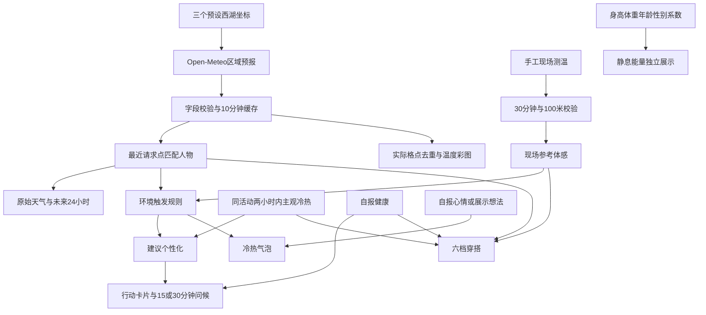

# FeelsLike 完整算法说明

版本日期：2026-11-15；对应已发布第五版提交 `bee82295d03d6d143a9c95021065ec114204fc39`。本文依据当前实现整理，主要供团队融合、复现和调整参数使用；没有新增算法或改变运行代码。

## 1. 总体计算链路



主页面优先在浏览器生成报告，服务端为回退链路。身体能量、健康文案、测温与情绪在本机计算。没有学习模型、疾病预测器或人体热平衡求解器。

## 2. 天气输入定义

实现：`public/weather-data.js`、`public/weather-client.js`、`api.mjs`。

| 请求点 | 纬度 | 经度 |
|---|---:|---:|
| 北岸 north | 30.264 | 120.145 |
| 南岸 south | 30.231 | 120.145 |
| 西岸 west | 30.249 | 120.123 |

接口：`https://api.open-meteo.com/v1/forecast`。三个经纬度以逗号传入，`forecast_days=3`、`timezone=Asia/Shanghai`、`timeformat=unixtime`、`wind_speed_unit=ms`。

当前字段10个：temperature_2m、relative_humidity_2m、apparent_temperature、precipitation、weather_code、cloud_cover、wind_speed_10m、wind_direction_10m、wind_gusts_10m、is_day。

逐时字段12个：除is_day外的上述字段，加shortwave_radiation、uv_index、precipitation_probability。辐射、UV、降雨概率从距离current.time最近的逐时记录取值，时间差须不超过1小时，否则该项为空。

### 2.1 校验与时间

- 返回记录数量必须等于三个请求点。
- 当前所需字段必须为有限数；逐时数组长度须与time一致、内容有限；时间严格递增。
- 当前时间不得超过系统时间15分钟；当前湿度0—100%，风/阵风非负。
- 逐时降雨概率0—100%，UV与短波辐射非负。
- 如服务声明风速单位，必须为m/s。
- 有效时刻距现在超过90分钟，或在未来超过15分钟，标记stale。

这组校验是当前实际实现，不代表已对服务端所有物理量逐一进行完整物理范围检测。客户端系统时钟会影响时效判断。

### 2.2 缓存、失败与429

浏览器缓存10分钟；缓存键`feelslike-public-weather-v1`。并发请求合并为同一任务。正常加载使用缓存；手动检查可请求更新，但不能跳过限流等待。浏览器请求15秒超时，服务端18秒。

429：优先解析Retry-After秒数或HTTP日期；缺失/不可解析时等待15分钟；等待限制在1分钟—24小时。普通网络/数据错误默认等待1分钟。浏览器将retryAt与错误信息保存，刷新页面仍遵守等待。

失败时若有缓存则保留缓存及原始有效时间；若无可用缓存，页面尝试`POST /api/telemetry`。页面5秒更新报告、定时器1秒检查，不等于上游5秒刷新。旧数据不会因重新计算而变为新数据。主页面设备直连成功时不采用旧SSE数据覆盖。

## 3. 人物与天气匹配、预报窗口

实现：`public/climate.js`。

局部平面距离近似：

```text
d = sqrt(((lon1-lon2)×96400)² + ((lat1-lat2)×111320)²)  // m
```

人物选择距离最近的预设请求点，沿用该点返回天气；不是对温度做空间插值。真实格点位置可能不同于请求位置，因此气象图另用返回坐标去重。

未来24小时：从当前时刻向上取整到下一整点（恰为整点时保留该整点），保留`[start,start+24小时)`内有限的逐时apparent_temperature；不拿今天已过去的小时填满图。

## 4. 现场参考体感

实现：`public/comfort.js`的apparentEstimate、observationContext。

输入：环境气温T（°C）、相对湿度RH（%）、参考10米风速v10（m/s）、短波辐射S（W/m²）。

```text
e  = RH/100 × 6.105 × exp(17.27T / (237.7+T))
v2 = 0.75 × v10
Q  = max(0, 0.1 × (S-550))       // S缺失时Q=0
AT = T + 0.348e - 0.70v2 + 0.70Q/(v2+10) - 4.25
```

e为水汽压近似，v2为近似2米风速，Q为辐射近似项。此式与Open-Meteo公开计算实现对齐；没有测量人体净辐射、衣着隔热或核心体温，不能称为UTCI。

| 条件 | 当前规则 |
|---|---|
| T | 必填，−50至60°C，0°C有效 |
| RH | 选填，0—100%；缺失时借用新鲜区域天气 |
| v10 | 选填，0—75m/s；缺失时借用新鲜区域天气 |
| S | 借用新鲜区域辐射，缺失时不加辐射项 |
| 时间 | 记录后≤30分钟；未来记录无效 |
| 位置 | 距记录沙盘位置≤100米 |
| 坐标范围 | 经度120.108—120.176、纬度30.215—30.281 |
| 无足够湿度/风速 | 只显示有效现场气温，不计算AT |

距离按第3节公式计算。30分钟与100米是产品参数，没有现场校准。手持近地风速不天然等于10米风速，输入前需明确测量高度；页面目前不会自动转换传感器数据。

区域预报体感保持API原值，现场参考体感单独展示。现场35°C、RH60%、v10=1m/s、S=0时，公式约得41.9°C；这是复现示例，不是西湖实测。

## 5. 冷热与环境规则

实现：`public/climate.js`的temperatureSignal、weatherTriggers、environmentReminder。

| 原因 | 触发条件 | 优先顺序 |
|---|---|---:|
| heat | 气温≥32°C或预报/参考体感≥32°C | 1 |
| wind | 阵风≥12m/s | 2 |
| cold | 气温≤10°C或体感≤5°C | 3 |
| activity | 跑步且体感≥26°C | 4 |
| rain | 降雨概率≥60%或降水>0.5mm | 5 |
| uv | UV≥6 | 6 |

温度信号先判热、再判冷；两者都不触发时为comfortable。无有效温度或stale为unknown。当前weatherTriggers先依赖有效温度信号，再生成风雨UV等原因；若只有风雨字段而温度缺失，不会单独产生环境报告。

personComfort分别检查区域天气与有效测温，把原因取并集，再按表排序。较凉的测温不能覆盖区域高温提醒。主code取第一项；有热或活动为attention，其他原因notice，无原因routine，无有效环境unknown。warningWeather优先选热，其次冷，再选现场或区域天气，供气泡和提醒计划使用。

这些是产品提示规则，不是官方气象预警等级或临床阈值；32°C等参数仍需用户研究和现场验证。

## 6. 主观冷热的作用

实现：feedbackIsCurrent、applyComfortFeedback。

有效反馈必须是cold/fine/hot；时间有限、非未来、距现在≤2小时，并与当前活动一致（历史未标活动的记录兼容）。UI删除/替换反馈后，不允许旧异步响应恢复它。

- hot：当原code为routine、activity或unknown时，主建议改为personalHot，保留原reasons并增加个人原因。
- cold：仅在原code为routine时改为personalCold。
- fine：保留环境建议。
- 其他已触发环境原因保留；穿搭还可叠加有效冷热反馈。

不实行“偏热就加2°C”的数值修正，也不根据次数训练个人温度模型。后续若要校准个体体感，需要配对环境、衣着、活动、主观量表以及独立验证数据。

## 7. 健康信息标准化与提醒计划

实现：`public/health.js`、`public/comfort.js`。

条件白名单：healthy、cold、heart、hypertension、diabetes、kidney、other。去重并过滤未知值；任何其他条件或限制饮水选项存在时移除healthy；仅other被选中时保存去空格后最多200字自填内容。未填写不等于已确认健康。

健康文案：感冒优先休息；其他健康情况结合是否热给出慢走、休息、避开最热时段和常用药提示；限制饮水附加已有医生安排；不解析自填内容为疾病分数。

```text
care = heart / hypertension / diabetes / kidney 至少一项
hot  = warningWeather触发heat，或同活动有效反馈为hot
minutes = care && hot ? 15 : 30
rest = fluidRestricted || conditions包含cold || (care && hot)
mode = rest ? 休息 : 饮水
```

app.js每秒比较当前时间与lastReminder；只有提醒开关打开且达到minutes才弹出页面提示并重置计时。开启开关、点击已补水也重置计时。页面暂停会影响时机，没有后台服务接管。

心情“疲惫”不自动成为病史；身高体重不改变此间隔；当前没有摄入量、脱水量、疾病风险概率或个体安全暴露时长。

## 8. 穿搭推荐

实现：`public/outfit.js`。温度选择依次为：有效现场参考体感→有效现场气温→新鲜区域预报体感→新鲜区域气温。没有有效温度则available=false。

| 温度区间 | 建议 |
|---|---|
| <0°C | 保暖内层、厚外套、长裤、围巾手套 |
| [0,10)°C | 毛衣、保暖外套、长裤 |
| [10,16)°C | 长袖、针织或薄外套、长裤 |
| [16,22)°C | 长袖或薄针织、方便穿脱的外层 |
| [22,28)°C | 轻薄透气上衣与下装 |
| ≥28°C | 浅色、宽松、轻薄衣物及阴凉休息 |

附加规则：平均风≥6m/s或阵风≥12m/s加防风层；雨条件加雨具/防滑鞋；UV≥6加遮阳防晒；跑步加排汗透气；近期偏热/偏冷加调整外层；感冒加休息提示。

六档是产品规则，未计算clo值或个体热平衡。第五版真实GLB衣着固定，按钮保存计划，算法不修改GLB贴图，也不因保存计划改变温度。

## 9. 静息能量估算

实现：`public/metabolism.js`，Mifflin–St Jeor（1990）。

```text
base = 10×weightKg + 6.25×heightCm - 5×age
REE_male   = base + 5          // kcal/day
REE_female = base - 161
watts = kcalPerDay × 4184 / 86400
```

未指定性别公式系数时返回女性系数至男性系数区间。身高80—250cm、体重20—350kg、整数年龄1—120为输入校验范围；实际公式仅参考19—78岁，范围外返回outside_reference_age；结果非正为invalid；缺少字段为incomplete。

该值是静息能量估算，不是活动消耗、人体实时产热或体感温度修正项。当前没有把REE直接输入冷热阈值、穿搭档位或定时提醒。

## 10. 心情与气泡

实现：`public/mood.js`。

先根据warningWeather调用temperatureSignal：heat→🥵与阴凉休息，cold→🥶与加衣；没有冷热触发时显示自报happy/calm/tired/irritable；未选心情时从五条展示想法轮换。

```text
hash = 人物ID字符码之和
index = (floor(now / 25000) + hash) mod 5
```

低动态模式冻结展示轮换。它是可复现展示逻辑，不是随机情绪识别；天气不能证明用户真实烦躁或开心。

## 11. 温度彩图算法

实现：`public/temperature-map.js`。

1. 过滤无效坐标、缺失气温、stale、超过90分钟或未来异常的数据。
2. 按返回的`latitude,longitude`合并重复格点，记录对应请求点ID。
3. 选择air或feels；在72×72显示栅格上逐像素查询最近格点，使用该点值。
4. 根据固定−10—40°C色阶做颜色插值；超出范围使用端点颜色，数值不截断。
5. 在彩色栅格上叠加OSM道路、建筑、标签和图例；拖动与缩放改变视窗。

常规色标节点：−10、0、10、20、30、40°C，颜色从紫蓝过渡到暖黄；色觉友好模式为连续蓝黄。72×72仅为渲染分辨率，不是新增了5,184个气象观测。

一个有效格点时整区同色；多个格点为最近样本分区，没有空间温差插值、树荫减温、地表温度或UTCI求解。现场单点测温不会扩散到地图。

## 12. 地形、路面与绿化

实现：`public/spatial.js`、`public/scene.js`。

局部投影原点lon=120.142、lat=30.248；东西按96400m/经度、南北按111320m/纬度；40米为一个场景单位，南北轴反向。用于小范围西湖展示，不是全球投影系统。

地形按所在栅格及其对角线做分片三角线性插值，再除以40并乘1.6垂直夸张。道路加密后沿同一地形网格和对角线裁切，路面略抬高，桥/水上路段设置下限；共享节点加接缝覆盖，主路与小路固定绘制顺序。视觉补缝不改变原路网拓扑。

宽度优先用OSM宽度并约束0.8—30m；缺失时按道路类型设默认值，例如主路14m、次干道11m、住宅路7m、footway3m、path2.2m。属于显示参数。

树木布置采用固定种子伪随机数，结合道路旁候选点与绿地区域。利用32m网格索引查询离道路边缘距离；树冠半径约1.7—2.4m，树冠边缘距路面至少1.1m；排除水域与建筑，树间距至少5.5m。树高约7—10m。不是逐树测绘。

## 13. 路网寻路与手动行走

OSM可步行道路的节点构成图，边按相邻节点连接，距离作路径代价；景点定位到可用步行节点后进行最短路搜索。分离的连通分量保持分离。寻路没有把树荫、天气或拥挤加入代价，因此当前不是“最凉路线”推荐。

手动移动在当前路段上消耗每帧位移，到节点后根据朝向选择可行边；后退保持面向，避免视角变化导致反复折返。自动路线按节点序列前进。键盘释放、失焦、隐藏页面时清除或暂停移动输入；相机模式与路网位移分离。

## 14. GLB缩放、动画与资源

实现：`public/rigged-avatar.js`、`public/avatar-assets.js`、`scripts/prepare_avatars.mjs`。

九个原始GLB由约3.4—4.3MB优化为约0.6—0.7MB：Meshopt压缩、512px WebP贴图、重采样动画冗余关键帧；不简化网格，保留41关节与idle/walk/run/turn/defeat_03/jump六段动作。仅选中模型加载，切换后释放旧纹理、材质、几何与动画资源。

加载后在待机姿态求包围盒，脚底归零，水平方向居中；`scale=1.7 / 原模型高度 / 40`；清单登记模型朝向。AnimationMixer按静止/步行/跑步淡入淡出，低动态可冻结动画。

走跑根轨迹只移除水平漂移，保留垂直起伏；OSM行走逻辑唯一负责场景平移，避免动画位移叠加。保留倒地动作素材不代表天气会自动让人物晕倒。

## 15. 数据边界与复现

真实区域预报、手动环境测温、主观冷热、静息能量和展示想法是不同数据类型；不可混写成“测得个体真实体感”。没有GPS、生命体征、实际衣着热阻或真实客流数据。

第五版此前通过60项测试，覆盖实际九个GLB骨骼/动画/身高、根运动处理、天气缓存/429、字段与时间、反馈时效、测温、健康、穿搭、温度图等。复现：`npm test`；构建：`npm run build`。该记录不是本次文档整理又做了一轮测试，也不证明临床有效或线上所有设备可用。

线上429已查明；第五版部署成功，本地设备直连读取真实天气已确认，线上恢复尚未确认。测试天气示例不可作为当前天气展示。

## 16. 后续融合时最应保留的约定

- 单位统一：温度°C、风m/s、时间戳明确秒/毫秒、经纬度顺序明确。
- 原始预报、现场输入和估算结果分别保存来源及有效时刻。
- 健康、身体、测温和心情默认本机保存，新增上传链路要单独设计。
- 不用模型外观代替真实身体信息，不用视觉树荫制造未经计算的降温。
- 新微气候模型需明确空间分辨率、输入、校准与误差，再替换彩图或路线代价。
- 新人物保留骨骼动作命名或提供映射，统一高度、朝向、脚底及根运动处理。

## 17. 方法与来源

以下为现有实现的来源索引，本文未重新联网核对外部页面版本。

- Open-Meteo字段：[Forecast API](https://open-meteo.com/en/docs)。
- 体感近似实现：[Meteorology.swift](https://github.com/open-meteo/open-meteo/blob/main/Sources/App/Helper/Meteorology.swift)，相关概念：[澳大利亚气象局](https://www.bom.gov.au/info/thermal_stress/)。
- 静息能量：[Mifflin–St Jeor，1990，PMID2305711](https://pubmed.ncbi.nlm.nih.gov/2305711/)。
- 健康提示背景：[CDC心血管疾病与高温](https://www.cdc.gov/heat-health/hcp/clinical-overview/heat-and-people-with-cardiovascular-disease.html)、[CDC慢性疾病与高温](https://www.cdc.gov/heat-health/risk-factors/heat-and-chronic-conditions.html)。
- 户外提示背景：[CDC户外工作与高温](https://www.cdc.gov/heat-health/risk-factors/heat-and-outdoor-workers.html)、[OSHA Water Rest Shade](https://www.osha.gov/heat-exposure/water-rest-shade/)。

算法的具体阈值以当前源码为准；科普来源不等于已验证本产品15/30分钟、32°C、100米或穿搭六档的有效性。


## 后续更新：阴影与500米插值

详见[2026-11-16更新](阴影体感与500米插值_20261116.md)。最新实现已采用实际步道支撑、逐点遮蔽与辐射来源区分，主读数为局地UTCI估算；彩图为500米IDW插值，替代前述最近点分区。
