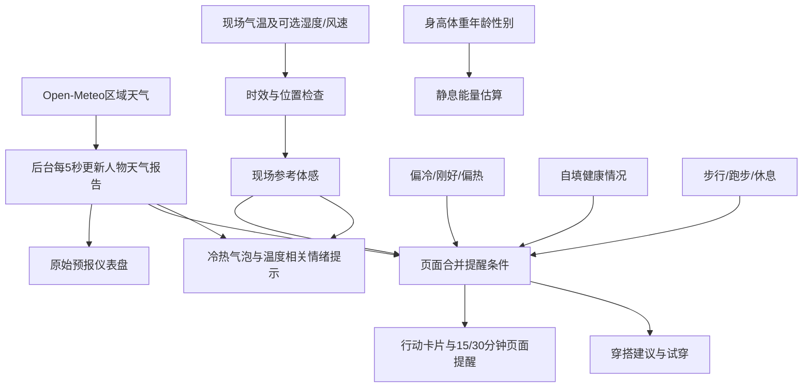

# FeelsLike：体感、健康提醒与穿搭算法

版本：2026-11-15，本地工程 `E:/AI for Climate/westlake-climate-lab`。

## 目前已经实现什么

一个可操纵人物，九种可选外观；切换外观保留位置、活动、健康与体感记录。支持现场温度计读数与主观冷热两种反馈。天气、测温、活动、健康情况共同改变页面建议、人物冷热气泡、穿搭和已开启的提醒计时。

健康情况是用户填写的资料。网页尚未接入手表、体温计或生命体征传感器，不能自动发现疾病。测温入口也是手动记录环境气温，不是体温；它关联沙盘中人物的当前位置，没有启用手机GPS。应先把人物放到实际测温的位置，再记录。

## 1. 数据怎样流动



后台只收到虚拟人物ID、沙盘位置、活动和近期冷热反馈。健康、其他情况自填内容、身高体重年龄性别、现场测温、心情与饮水记录保存在当前浏览器，不进入遥测。切换设备目前不会同步这些记录。

## 2. 预报与现场体感分别计算

### 区域预报

主仪表盘保留服务返回的 `apparent_temperature`，不因人物外观、病史或点了“偏热”而改写。Open-Meteo返回气象模型当前时段输出；三处西湖请求目前落在同一个实际格点，不能据此宣称每条路都有独立实测值。[Open-Meteo接口文档](https://open-meteo.com/en/docs)

后台缓存10分钟，页面报告每5秒更新；这不代表上游每5秒产生一条新的气象观测。气象有效时刻超过90分钟标为过期，不触发新的天气判断。

### 现场参考体感

实现：`public/comfort.js → apparentEstimate / observationContext`。

记环境气温为 T（°C），相对湿度 RH（%），参考10米风速 v10（m/s），短波辐射 S（W/m²）：

```
e = RH / 100 × 6.105 × exp(17.27T / (237.7 + T))
v2 = 0.75 × v10
Q = max(0, 0.1 × (S − 550))      // S缺失时Q=0
AT = T + 0.348e − 0.70v2 + 0.70Q / (v2 + 10) − 4.25
```

这是Open-Meteo公开实现使用的近似式与风速换算。Q为辐射近似项，没有测量人体实际吸收的净辐射；不能把阴影中的人物模型当作测量到的遮阴效果。[Open-Meteo公式源码](https://raw.githubusercontent.com/open-meteo/open-meteo/main/Sources/App/Helper/Meteorology.swift)、[澳大利亚气象局体感计算说明](https://www.bom.gov.au/info/thermal_stress/)

输入和有效性规则：

| 项目 | 当前实现 |
|---|---|
| 环境气温 | 必填，−50至60°C；保留0°C |
| 湿度 | 可选，0至100%；未填时参考尚未过期的区域天气 |
| 风速 | 可选，0至75m/s，按参考10米风速输入；手持风速仪的近地读数需另做高度处理 |
| 辐射 | 参考尚未过期的区域天气；缺失时不增加辐射项 |
| 时间 | 记录后30分钟有效；未来时间无效 |
| 位置 | 距人物记录位置100m以内有效；走远后重新记录 |
| 缺少湿度/风速且没有新鲜预报 | 显示现场气温，不虚构现场体感 |

30分钟与100m是本产品用于避免重复使用旧测温的参数，尚未经现场校准。区域湿度、风和辐射也可能与实际小环境不同，因此单独显示“现场参考体感”及其输入来源。

示例：测试输入35°C、RH60%、参考风速1m/s、辐射0，计算约41.9°C。浏览器联动检查使用过这条测试记录，检查后已删除；它不是西湖实测天气。

## 3. 主观冷热怎样影响结果

实现：`public/climate.js → feedbackIsCurrent / applyComfortFeedback`。

反馈分为偏冷、刚好、偏热，只有同一活动下最近2小时内的记录有效。切换活动、记录过期、时间在未来或删除反馈后，不再沿用。旧的异步后台响应也不能恢复已删除或被替换的反馈。

- 偏热：在日常、活动或暂无天气的情形下，把主建议改为放慢脚步、找阴凉、休息；穿搭增加可脱外层建议。
- 偏冷：日常建议改为加衣、避风；穿搭增加方便穿脱的外层建议。
- 刚好：保留已有的环境提醒。
- 已有高温、低温、大风、降雨、UV提醒继续保留，多条件可以并存。

“偏热”并不等于“比预报高2°C”。当前没有经过个人校准的数值修正模型，因此主观反馈改变服务建议，不给预报或现场体感随意加减温度。若未来要输出数值化的个体体感，需要配对采集环境测量、衣着、活动和主观量表，并以独立样本验证。

## 4. 环境和健康如何触发提醒

实现：`public/climate.js / public/health.js / public/comfort.js`，页面在 `public/app.js` 中执行。

| 条件 | 当前产品触发规则 |
|---|---|
| 热 | 气温或体感≥32°C |
| 冷 | 气温≤10°C，或体感≤5°C |
| 活动 | 跑步且体感≥26°C |
| 大风 | 阵风≥12m/s |
| 雨 | 降雨概率≥60%，或降水>0.5mm |
| 强紫外线 | UV≥6 |

分别检查有效区域天气和有效测温，合并原因，优先级为热、风、冷、活动、雨、UV。一条较凉的测温不会删除已有的区域高温提示。人物头顶只在冷热触发时显示天气警示；其他时候显示心情或随机想法。

| 健康资料 | 对网页的实际影响 |
|---|---|
| 健康 | 保留普通天气与休息提示 |
| 感冒 | 卡片优先建议休息；计时改为休息问候；穿搭区补充休息建议 |
| 心脏病/高血压/糖尿病/肾脏疾病 | 增加休息、避开最热时段和常用药准备提示；热条件下缩短已开启的提醒间隔 |
| 医生要求限制饮水 | 将计时提醒改为休息，饮水提示遵循医生安排 |
| 其他自填 | 保留原文并提示依照平时照护安排，不自动解析成疾病分值 |

计时算法：

```
care = 有心脏病、高血压、糖尿病或肾脏疾病中的至少一项
hot = 有效天气/测温触发热，或近期同活动反馈为偏热
interval = care && hot ? 15分钟 : 30分钟
mode = 限制饮水 || 感冒 || (care && hot) ? 休息 : 饮水
```

用户开启提醒后，这个interval会真正控制页面计时和弹出提示。15/30分钟是产品问候节奏，不是医学处方，也不是安全停留时间；尚无现场试验支持其最优性。健康建议参考[CDC心血管疾病与高温](https://www.cdc.gov/heat-health/hcp/clinical-overview/heat-and-people-with-cardiovascular-disease.html)及[CDC慢性疾病与高温](https://www.cdc.gov/heat-health/risk-factors/heat-and-chronic-conditions.html)。

目前网页打开、浏览器执行脚本时可以提示。手机切到后台、锁屏或关闭页面后，系统可能暂停脚本；可靠后台提醒尚需HTTPS、Service Worker、用户通知许可、Web Push订阅与服务端调度。仅增加定时器不能完成手机后台提醒。

## 5. 穿搭算法

实现：`public/outfit.js → recommendOutfit`。

优先用有效现场参考体感；无法计算现场体感时用有效现场气温；没有有效测温时用新鲜预报体感，缺少预报体感时用预报气温。没有有效温度时停用试穿按钮。

| 参考温度 | 基础建议 | 人物试穿 |
|---|---|---|
| <0°C | 保暖内层、厚外套、长裤、围巾手套 | 保暖外套 |
| 0至<10°C | 毛衣、保暖外套、长裤 | 保暖外套 |
| 10至<16°C | 长袖、针织/薄外套、长裤 | 分层穿搭 |
| 16至<22°C | 长袖或薄针织、可脱外层 | 分层穿搭 |
| 22至<28°C | 轻薄透气上衣与下装 | 轻便穿搭 |
| ≥28°C | 浅色、宽松、轻薄衣物，安排阴凉休息 | 轻便穿搭 |

再叠加：风速≥6m/s或阵风≥12m/s加防风层提示；雨条件加雨具/防滑鞋；UV≥6加遮阳与防晒；跑步加透气排汗；近期主观冷热加调整外层；感冒加休息建议。

六档边界和风雨附加条件是可调整的产品规则，不是经过个人衣着实验验证的模型。轻薄宽松衣着原则参考[CDC热天户外活动](https://www.cdc.gov/heat-health/risk-factors/heat-and-outdoor-workers.html)，冷天分层原则参考[CDC/NIOSH冷应激说明](https://www.cdc.gov/niosh/cold-stress/about/)。试穿用于展示，不反向改变环境温度或假定真实衣着已经改变；目前也未计算衣服clo值。

## 6. 基础代谢放在哪里

`REE = 10×体重kg + 6.25×身高cm − 5×年龄 + 性别系数`，男性+5，女性−161；未填写性别系数时显示区间。`W = kcal/day × 4184 / 86400`。当前参考年龄19–78岁。[Mifflin–St Jeor论文](https://pubmed.ncbi.nlm.nih.gov/2305711/)

这部分估算静息能量，用于身体消耗展示；当前没有将其直接加入环境体感温度。它不等于步行/跑步的实际代谢产热，也不能单独预测核心体温。当前没有实现个体热平衡模型、心率监测、脱水量预测或临床风险分数。外观选择不推断年龄、性别或健康。

## 7. 技术栈与当前限制

现有HTML/CSS/ES Modules、Three.js与Node/Worker足以支撑当前功能，没有必须换技术栈的阻碍。人物和空间资源随工程打包，前端无需构建框架。21项资源内嵌到Worker，当前约4.82MB。

真正需要补齐的是：

- 人物原素材是九张PNG三视图，没有GLB/FBX或可复用骨骼。现已按图重建可操纵的程序化模型；若要求原图精细还原，需要制作带骨骼的3D资产。
- WebGL设备可以显示3D人物；不支持WebGL时保留二维地图降级。大规模路网和地形仍需要在目标手机实机测试性能。
- 目前手工输入现场气温；蓝牙温度计、手表生命体征和GPS尚未连接。
- 可靠手机后台通知需要推送链路，当前只有页面内提醒。
- tjweather缺有效key/subscriptionId，真实今日客流也尚未接入；现用Open-Meteo真实预报，未填充模拟数据。
- 个人健康和主观感受当前属于规则个性化；实际提醒效果、温度分档和空间有效范围需要真实游客试用验证。

## 8. 验证结果

`node --test tests/*.test.mjs`：50项通过。新测试覆盖公式、零值/缺失值、测温时空有效性、预报不被改写、个人反馈有效期、健康提醒间隔、穿搭边界、九种人物的四肢关节和1.7m身高、界面元素及双语文案。

`node scripts/build.mjs`：21项资源构建成功。本地浏览器确认人物选择、换外观保留位置与已有健康记录、测温联动冷热气泡与穿搭、试穿/恢复、中英文切换；无控制台错误或警告。测试测温已清除。

真实接口检查：Open-Meteo HTTP200，三处请求均具备10个current字段、12个hourly字段和72小时样本，返回格点数量为1；原始结果见 `verification/api.json`。最新工程尚未发布到线上。


## 9. 温度彩图与手机界面更新

新增public/temperature-map.js，沿用后台报告中的区域气温和预报体感，按服务实际返回的经纬度去重。只有一处格点时全区保持同一色阶；多格点时使用邻近样本着色，不插入街道、树木、湖面或建筑温差。没有计算UTCI、地表温度或经过校准的微气候模型。固定色标−10至40°C，越界值以端点颜色显示，数值仍保留真实值；提供色觉友好的连续蓝黄配色。

缺失温度、无效坐标、超过90分钟的天气、异常未来时间与已标过期的报告不进入彩图。点击地图显示附近预报，现场测温和主观反馈不扩散为整张地图的温度。

手机390×844、窄屏及1280×900宽屏界面已实际浏览器检查：地点/视角可展开与收起，温度模式与3D模式一键切换，图例、气温/体感切换、缩放与复位正常，无应用控制台错误。手机标题与操作说明收起，工具栏移到地图上方。

新增3项测试覆盖重复格点、缺失/过期数据与固定色标，最新合计53项自动测试通过。


## 10. 天气获取与GLB人物更新

原线上天气缺失由服务端上游HTTP429确认。主页面改为设备直连Open-Meteo公开API，10分钟本机缓存，5秒更新人物报告；429按Retry-After等待，退避跨刷新保存；失败保留原有效时间，不创造数据。必要时尝试原服务端接口。天气先于3D模型独立加载，避免把模型下载时间误认为天气断开。个人健康、测温和身体资料仍不发送给天气提供方，提供方只接收预设的三个西湖请求坐标。

接入九个用户GLB模型，使用其真实41关节骨架和六段动画。按动作状态播放idle/walk/run，保留其他三段素材；没有根据天气自动播放晕倒。模型归一1.7m，水平根位移由动画中移除，人物位移仍来自真实路网。衣着建议保持规则算法；实际GLB服装固定，按钮保存穿搭计划。

最新测试60项通过；浏览器已确认设备直连读到15.1°C气温/14.9°C预报体感（气象时刻22:45），该数值只说明核验时的真实预报，不代表后续时刻或现场实测。人物切换保留位置，松键后moving=false，九个实际模型均已正面渲染检查。
